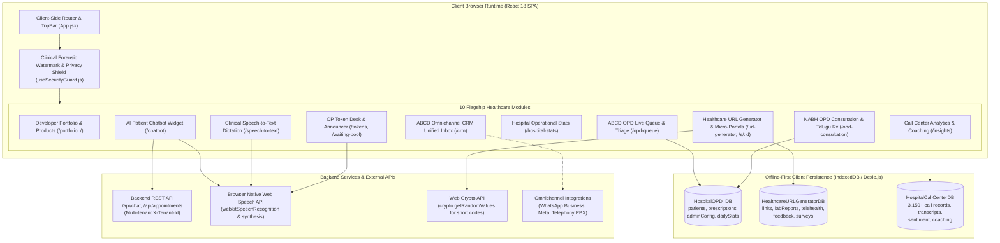

# ABCD Multispecialty Hospital – Digital Health Suite
## Comprehensive Technical Knowledge Base

Welcome to the **ABCD Multispecialty Hospital & Digital Health Suite** technical documentation. This knowledge base provides an exhaustive reference for software engineers, clinical informatics architects, QA specialists, and system administrators.

Every document in this repository is grounded strictly in the verified source code of the project.

---

## 1. System Architecture Overview

The system is engineered as an offline-resilient, client-side Single Page Application (SPA) built with React 18, Vite, Tailwind CSS, and Dexie.js (IndexedDB). It encompasses 10 cohesive healthcare and operational modules supported by an anti-capture security guard, Web APIs (Speech, Audio, Crypto), and a simulated/configurable REST API layer.



---

## 2. Master Table of Contents

| Document | Description | Primary Target Audience |
| :--- | :--- | :--- |
| [**1. Project Overview**](project-overview.md) | Mission, module catalog, full directory breakdown, and technology stack version matrix. | All Developers & Architects |
| [**2. Validation Rules**](validation-rules.md) | Form & field validations, regex limits, NABH mandatory checkpoints, CDSS drug alerts, and library audits. | Frontend & QA Engineers |
| [**3. API Documentation**](api-documentation.md) | REST endpoints, payloads, transports, multi-tenant headers, translation provider, and mock vs production modes. | Backend & Full-Stack Developers |
| [**4. Database Documentation**](database-documentation.md) | Complete Dexie.js / IndexedDB schemas (`HospitalOPD_DB`, `HealthcareURLGeneratorDB`, `HospitalCallCenterDB`), indexes, and access patterns. | Database & Core Developers |
| [**5. Feature Documentation**](feature-documentation.md) | In-depth workflows, clinical business logic, component hierarchy, and data flow for all 10 modules. | Product Managers & Engineers |
| [**6. Configuration & Deployment**](configuration.md) | Environment variables, build/test scripts, Vercel SPA rewrites (`vercel.json`), and hosting specifications. | DevOps & Release Engineers |
| [**7. Code Navigation & Developer Recipes**](code-navigation.md) | Key files directory, custom hooks catalog (`useHospitalData`, `useSecurityGuard`), state patterns, and extension recipes. | New & Contributing Developers |
| [**8. Verification & Unverified Areas**](verification-and-unverified-areas.md) | Technical audit, mock vs production gaps, unused dependencies analysis, and manual QA checklists. | QA Engineers & Technical Leads |

---

## 3. Fast Reference: Common Operations

- **Start Local Development**:
  ```bash
  npm run dev
  ```
  Runs Vite dev server on `http://localhost:5173`.
- **Run Automated Tests**:
  ```bash
  npm test
  ```
  Executes the Playwright end-to-end and smoke test suite across all modules.
- **Production Build**:
  ```bash
  npm run build
  ```
  Compiles optimized production bundles with chunk splitting in `dist/`.
- **Verify Vercel SPA Routing**:
  Ensure [vercel.json](../vercel.json) rewrites all incoming requests to `/index.html` to prevent 404 errors on browser page reloads.

---

## 4. Key Architectural Tenets

1. **Patient Data Privacy & Security First**: Built-in forensic watermarking with doctor UHID, IP address, and timestamp overlays, paired with automatic screen blackout when switching windows or initiating unwhitelisted screen captures.
2. **Clinical Offline Resiliency**: Core clinical workflows—such as OPD queue triaging, vital signs recording, draft prescription autosave, and local analytics—function completely offline via IndexedDB.
3. **NABH Accreditation Compliance**: Enforces 4 mandatory clinical checkpoints (Chief Complaints, Vitals, Allergies, Diagnosis) before enabling digital signature and prescription finalization.
4. **Bilingual Healthcare Accessibility**: Prescription instructions and medications seamlessly render in both English and Telugu for local patient comprehension.
