# Database Documentation & Client-Side Storage
[Back to Master Index](README.md)

This document provides a comprehensive technical reference for the client-side database layer built on **IndexedDB** using **Dexie.js (`^4.4.6`)** and **`dexie-react-hooks` (`^4.4.0`)**.

The platform maintains 3 independent database instances in the client's browser to deliver zero-latency queries, offline functionality, and resilient state persistence.

---

## 1. Database Architecture & Stores Overview

```mermaid
erDiagram
    HospitalOPD_DB ||--o{ patients : contains
    HospitalOPD_DB ||--o{ prescriptions : contains
    HospitalOPD_DB ||--o{ adminConfig : contains
    HospitalOPD_DB ||--o{ customDictionary : contains
    HospitalOPD_DB ||--o{ hospitalStats : contains
    HospitalOPD_DB ||--o{ dailyStats : contains

    HealthcareURLGeneratorDB ||--o{ links : routes
    HealthcareURLGeneratorDB ||--o{ labReports : stores
    HealthcareURLGeneratorDB ||--o{ labReportAttachments : blobs
    HealthcareURLGeneratorDB ||--o{ telehealthMeetings : stores
    HealthcareURLGeneratorDB ||--o{ feedbackForms : stores
    HealthcareURLGeneratorDB ||--o{ feedbackResponses : stores
    HealthcareURLGeneratorDB ||--o{ surveys : stores

    HospitalCallCenterDB ||--o{ calls : indexes
```



---

## 2. Database 1: `HospitalOPD_DB`

- **Source File**: [`src/db/hospitalDb.js`](../src/db/hospitalDb.js)
- **Primary Use**: Outpatient queue management, live patient triage, clinical digital prescriptions, and operational hospital stats.

### 2.1 Version History & Schema Migrations
```javascript
// Version 1 Schema
hospitalDb.version(1).stores({
  patients: "id, uhid, tokenNumber, name, queueStatus, consultationType, priority",
  prescriptions: "id, patientId, status, updatedAt, isFinalized",
  adminConfig: "sectionKey, isMandatory, isEnabled",
  customDictionary: "id, shortcut, category",
});

// Version 2 Schema (Added hospital operational metrics)
hospitalDb.version(2).stores({
  hospitalStats: "timeframe",
});

// Version 3 Schema (Added daily historical operational stats)
hospitalDb.version(3).stores({
  dailyStats: "date",
});
```

### 2.2 Object Store Schemas & Field Definitions

#### Store: `patients`
| Field Name | Type | Key / Index | Description | Example Value |
| :--- | :--- | :--- | :--- | :--- |
| `id` | String | **Primary Key** | Unique patient identifier (`pat_...`). | `"pat_10482"` |
| `uhid` | String | **Indexed** | Unique Hospital Identification Number. | `"UHID-10482"` |
| `tokenNumber` | String | **Indexed** | Daily sequence token number. | `"#W-04"`, `"#TC-02"` |
| `name` | String | **Indexed** | Patient full name. | `"Anita Verma"` |
| `age` | Number | Data field | Patient age in years. | `28` |
| `gender` | String | Data field | Patient gender (`"Female"`, `"Male"`). | `"Female"` |
| `phone` | String | Data field | Patient contact mobile number. | `"+91 98765 43210"` |
| `queueStatus` | String | **Indexed** | Live triage status: `"waiting"`, `"in_consultation"`, `"sent_for_labs"`, `"completed"`, `"no_show"`. | `"waiting"` |
| `consultationType`| String | **Indexed** | `"walk_in"`, `"online"`, `"tele_consultation"`. | `"walk_in"` |
| `priority` | String | **Indexed** | Triage triage level: `"normal"`, `"urgent"`, `"emergency"`. | `"urgent"` |
| `isPregnant` | Boolean | Data field | Pregnancy status flag. | `true` |
| `pregnancyDetails`| Object | Data field | Trimester, gestational weeks, EDD. | `{ trimester: "2nd", gestationalWeeks: 22 }` |
| `isHandicapped` | Boolean | Data field | Physical accessibility flag. | `false` |
| `allergies` | Array | Data field | Documented drug or food allergies. | `["Penicillin"]` |
| `vitals` | Object | Data field | BP, pulse, temp, spo2, weight, height, BMI. | `{ bp: "110/70", pulse: 82, spo2: 99 }` |
| `chiefComplaintSummary` | String | Data field | Summary text for triage card preview. | `"Hyperemesis Gravidarum with severe nausea"` |
| `scheduledTime` | String | Data field | Appointment or arrival time string. | `"09:45 AM"` |
| `consultationStartTime` | Number/null | Data field | Unix timestamp when doctor opened room. | `1729674300000` |

#### Store: `prescriptions`
| Field Name | Type | Key / Index | Description | Example Value |
| :--- | :--- | :--- | :--- | :--- |
| `id` | String | **Primary Key** | Unique prescription ID. | `"rx_pat_10482"` |
| `patientId` | String | **Indexed** | Foreign key linking to `patients.id`. | `"pat_10482"` |
| `status` | String | **Indexed** | `"draft"`, `"submitted"`, `"signed"`. | `"draft"` |
| `isFinalized` | Boolean | **Indexed** | Digital signature lock status. | `false` |
| `updatedAt` | Number | **Indexed** | Timestamp of last modification. | `1729674500000` |
| `chiefComplaints` | Array | Data field | Array of clinical complaint items. | `[{ complaint: "Vomiting", duration: "3 days" }]` |
| `vitals` | Object | Data field | Consultation vital signs. | `{ bp: "110/70", pulse: "82" }` |
| `allergies` | Array | Data field | Consultation confirmed allergies. | `["Penicillin"]` |
| `diagnosis` | Object | Data field | Provisional and final ICD diagnoses. | `{ provisional: "Hyperemesis Gravidarum" }` |
| `medications` | Array | Data field | List of Rx items with dosage and timing. | `[{ drugName: "Doxylamine", dose: "10mg", frequency: "1-0-1", timing: "Before Food" }]` |
| `investigations` | Array | Data field | Ordered diagnostic lab/radiology tests. | `[{ testName: "CBC with Platelets", status: "ordered" }]` |
| `dietAdvice` | String | Data field | Dietary and lifestyle instructions. | `"Small frequent bland meals. Oral rehydration."` |
| `followUp` | Object | Data field | Follow-up timeframe or specific date. | `{ duration: "5 days", date: "2026-10-27" }` |

#### Store: `adminConfig`
| Field Name | Type | Key / Index | Description |
| :--- | :--- | :--- | :--- |
| `sectionKey` | String | **Primary Key** | Unique section ID (e.g. `"chief_complaints"`, `"vitals"`). |
| `isMandatory` | Boolean | **Indexed** | Flag indicating if completion is required to sign Rx. |
| `isEnabled` | Boolean | **Indexed** | Flag indicating if section is visible in the workspace. |

---

## 3. Database 2: `HealthcareURLGeneratorDB`

- **Source File**: [`src/db/database.js`](../src/db/database.js)
- **Primary Use**: Healthcare cryptographic short-link resolution, clinical document definitions, and patient feedback.

```javascript
db.version(1).stores({
  links: "++id, &shortCode, moduleType, title, destinationId, destinationUrl, createdAt, expiresAt, isActive",
  labReports: "++id, title, remarks, createdAt",
  labReportAttachments: "++id, reportId, originalFilename, mimeType, fileSize",
  telehealthMeetings: "++id, doctorName, doctorDesignation, meetingTitle, meetingDate, meetingTime, description, videoMeetingUrl, createdAt",
  feedbackForms: "++id, title, createdAt, expiresAt, isActive",
  feedbackResponses: "++id, feedbackFormId, hospitalStaffRating, doctorTreatmentRating, overallHospitalRating, submittedAt",
  surveys: "++id, title, originalUrl, createdAt",
});
```

### Store Highlights:
- **`links`**: Core routing table. `shortCode` is a **unique unique-indexed key** (`&shortCode`) preventing duplicate cryptographic tokens.
- **`labReportAttachments`**: Stores actual binary `Blob` data inside IndexedDB, enabling offline preview of clinical PDFs and PNG scans.
- **`feedbackResponses`**: Stores structured ratings ($1$ to $5$ stars) and suggestions submitted by patients via short links.

---

## 4. Database 3: `HospitalCallCenterDB`

- **Source File**: [`src/services/callCenterDb.js`](../src/services/callCenterDb.js)
- **Primary Use**: Performance auditing for hospital call center operations.
- **Database Name**: `"HospitalCallCenterDB"` (Version 8).
- **Volume**: Seeds and maintains **3,150+ realistic clinical call records** covering 1 full month of operations across 12 agents and multiple languages (English, Telugu, Hindi, Tamil, Marathi).

### Store: `calls`
```javascript
// Schema index
calls: "++id, callId, agentName, timestamp, callStatus, sentiment, language, duration, patientName"
```

---

## 5. Reactive Query Patterns (`dexie-react-hooks`)

Components subscribe to live database queries using the `useLiveQuery` hook. When records are inserted, updated, or deleted, components re-render automatically without manual polling:

```javascript
// Example from src/hooks/useHospitalData.js
import { useLiveQuery } from "dexie-react-hooks";
import { hospitalDb } from "../db/hospitalDb.js";

export function useHospitalData() {
  const patients = useLiveQuery(
    () => hospitalDb.patients.orderBy("tokenNumber").toArray(),
    []
  ) || [];

  const prescriptions = useLiveQuery(
    () => hospitalDb.prescriptions.toArray(),
    []
  ) || [];

  return { patients, prescriptions };
}
```

---

## 6. Seed Data & Initialization Logic

- **Source File**: [`src/db/seedData.js`](../src/db/seedData.js)
- **Execution Hook**: Automatically invoked upon database creation (`hospitalDb.on("populate")`) and on browser initialization:
  ```javascript
  if (typeof window !== "undefined") {
    seedInitialDataIfEmpty(hospitalDb).catch((err) => {
      console.warn("HospitalOPD_DB initialization check:", err);
    });
  }
  ```
- **Seeded Entities**:
  - 18 realistic outpatient cases spanning General Medicine, Cardiology, Obstetrics, and Orthopedics.
  - Multi-lane distribution: 6 Waiting Walk-ins, 2 Online Booked, 2 Tele-Consultations, 2 Sent for Labs (Drafts), 5 Completed Prescriptions.
  - Pre-configured drug contraindication cases (e.g. Anita Verma with Penicillin allergy & pregnancy).
