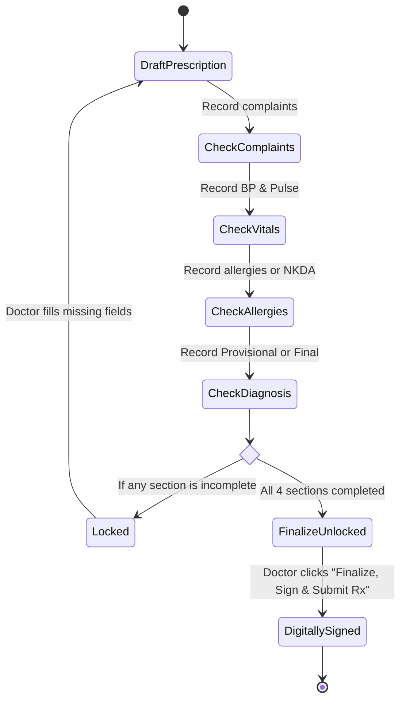

# Validation Rules & Clinical Safety Checks
[Back to Master Index](README.md)

This document provides a comprehensive technical catalog of all validation rules, regex patterns, field constraints, clinical safety algorithms (CDSS), and error handling flows implemented across the codebase.

---

## 1. Summary Matrix of Forms & Validations

| Module / Form | File Path & Function | Validation Mechanism | Key Constraints & Format Rules | Error Messages |
| :--- | :--- | :--- | :--- | :--- |
| **Chatbot Patient Intake** | [`src/components/PatientRegistrationForm.jsx`](../src/components/PatientRegistrationForm.jsx)<br>`validate()` | Custom Controlled State | - `name`: Non-empty trimmed string.<br>- `mobile`: Exactly 10 digits (`/^\d{10}$/`). | `"Enter the patient's name"`<br>`"Enter a valid 10-digit mobile number"` |
| **OPD Walk-in Quick Intake** | [`src/components/queue/QuickPatientIntakeModal.jsx`](../src/components/queue/QuickPatientIntakeModal.jsx)<br>`handleSubmit()` | Custom Controlled State | - `name`: Required non-empty string.<br>- `sys` & `dia`: Parsed integers, defaults `120/80`.<br>- `weight` & `height`: Numbers > 0 for BMI calculation. | Silent submission block on empty name. |
| **NABH Consultation Lock** | [`src/components/consultation/MandatoryProgressChecklist.jsx`](../src/components/consultation/MandatoryProgressChecklist.jsx) | Dynamic Clinical Rule Engine | - 4 Mandatory NABH Sections:<br>1. Complaints: `length > 0`<br>2. Vitals: `bp` & `pulse` present<br>3. Allergies: Explicit list or `"NKDA"`<br>4. Diagnosis: Provisional or final filled | `"Complete 4 required sections to unlock Finalize"` |
| **CDSS Drug-Allergy Checker** | [`src/components/consultation/AiCdssAlertCard.jsx`](../src/components/consultation/AiCdssAlertCard.jsx) | Clinical Rule Engine | - Allergy cross-check: Penicillin / Amoxicillin / Augmentin.<br>- Pregnancy check: Category D/X drugs (NSAIDs, ACE inhibitors). | Visual high-alert banner with contraindication rationale. |
| **Short URL - Lab Report** | [`src/components/url-generator/LabReportForm.jsx`](../src/components/url-generator/LabReportForm.jsx)<br>`handleSubmit()` | Custom State & Error Map | - `patientName`: Required non-empty.<br>- `doctorName`: Required selection.<br>- `tests`: At least 1 test selected. | `"Patient name is required"`<br>`"Doctor name is required"`<br>`"Select at least one test"` |
| **Short URL - Telehealth** | [`src/components/url-generator/TelehealthForm.jsx`](../src/components/url-generator/TelehealthForm.jsx)<br>`validate()` | Custom State & Error Map | - `doctorName`: Required.<br>- `meetingDate` & `time`: Required.<br>- `videoMeetingUrl`: Valid URL format (`/^https?:\/\/.+/`). | `"Doctor name is required"`<br>`"Meeting date is required"`<br>`"Enter a valid HTTP/HTTPS URL"` |
| **Short URL - Feedback** | [`src/components/url-generator/FeedbackForm.jsx`](../src/components/url-generator/FeedbackForm.jsx)<br>`handleSubmit()` | Controlled Rating Logic | - Ratings: 1 to 5 integer scale for staff, doctor, hospital.<br>- `title`: Non-empty. | Default star ratings (5) applied if untouched. |
| **Short URL - Survey** | [`src/components/url-generator/SurveyForm.jsx`](../src/components/url-generator/SurveyForm.jsx)<br>`handleSubmit()` | Regex Validation | - `title`: Non-empty.<br>- `originalUrl`: Required valid URL (`/^https?:\/\/.+/`). | `"Title is required"`<br>`"Enter a valid URL starting with http:// or https://"` |
| **Short Code Resolver** | [`src/services/shortUrlService.js`](../src/services/shortUrlService.js)<br>`validateShortCode()` | Cryptographic Regex | - Exactly 7 characters from Base56 alphabet (`[a-km-zA-HJ-NP-Z2-9]{7}`). | Rejection / 404 on invalid character or length. |
| **Doctor Profile Editor** | [`src/components/opd-portal/DoctorProfileView.jsx`](../src/components/opd-portal/DoctorProfileView.jsx)<br>`handleSave()` | Controlled State | - `name`: Non-empty.<br>- `fee`: Positive integer (`> 0`).<br>- `email`: Standard email regex pattern. | Visual toast warning on invalid field values. |
| **CRM Agent Profile** | [`src/components/crm/CrmAgentProfileModal.jsx`](../src/components/crm/CrmAgentProfileModal.jsx)<br>`handleSave()` | Controlled State | - `name`: Non-empty.<br>- `email`: Email regex pattern.<br>- `maxActiveChats`: Integer between 1 and 20. | Field-level error indicator. |

---

## 2. Detailed Form & Field Validations

### 2.1 Chatbot Patient Registration Form
- **Source File**: [`src/components/PatientRegistrationForm.jsx`](../src/components/PatientRegistrationForm.jsx) (Lines 21–28)
- **Validation Function**: `validate()`
- **Rules**:
  ```javascript
  const validate = () => {
    const next = {};
    if (!name.trim()) next.name = "Enter the patient's name";
    if (!/^\d{10}$/.test(mobile.trim())) next.mobile = "Enter a valid 10-digit mobile number";
    setErrors(next);
    return Object.keys(next).length === 0;
  };
  ```
- **Formatting**: The mobile input automatically strips non-numeric characters and enforces a 10-digit maximum:
  ```javascript
  onChange={(e) => setMobile(e.target.value.replace(/\D/g, "").slice(0, 10))}
  ```
- **Lifecycle**: Upon valid submission, the form transitions to an immutable "receipt" card, preventing duplicate submissions.

---

### 2.2 Quick Patient Intake Modal
- **Source File**: [`src/components/queue/QuickPatientIntakeModal.jsx`](../src/components/queue/QuickPatientIntakeModal.jsx) (Lines 56–83)
- **Rules**:
  - `name`: Enforced non-empty check (`if (!formData.name.trim()) return;`).
  - `sys` (Systolic BP): Parsed as integer, default fallback `120`.
  - `dia` (Diastolic BP): Parsed as integer, default fallback `80`.
  - `pulse`: Parsed as integer, default fallback `76`.
  - `spo2`: Parsed as integer, default fallback `99`.
  - `temp`: Parsed as float, default fallback `98.4`.
  - `weight` & `height`: Parsed as floats, defaults `65 kg` and `165 cm`.
  - **Dynamic BMI Calculation Formula**:
    $$\text{BMI} = \frac{\text{weight (kg)}}{(\text{height (m)})^2} = \frac{\text{weight}}{(\text{height} / 100)^2}$$
    Rounded to 1 decimal place. If invalid, falls back to `22.5`.

---

### 2.3 NABH Mandatory Clinical Consultation Checklist
- **Source File**: [`src/components/consultation/MandatoryProgressChecklist.jsx`](../src/components/consultation/MandatoryProgressChecklist.jsx) (Lines 22–72)
- **Source File**: [`src/components/consultation/OpdConsultationWorkspace.jsx`](../src/components/consultation/OpdConsultationWorkspace.jsx) (Lines 1210–1225)
- **Accreditation Constraint**: Under NABH guidelines, a digital outpatient prescription cannot be finalized, signed, or submitted unless all 4 mandatory clinical modules are fulfilled:



#### The 4 Mandatory Evaluation Conditions:
1. **Chief Complaints (`sec-complaints`)**:
   `rxForm.chiefComplaints.length > 0`
   Must contain at least 1 complaint entry with duration and severity.
2. **Vitals Monitoring (`sec-vitals`)**:
   `!!((rxForm.vitals?.bp || patient.vitals?.bp) && (rxForm.vitals?.pulse || patient.vitals?.pulse))`
   Both Blood Pressure and Pulse/Heart Rate must be recorded.
3. **Allergy Status Verification (`sec-allergies`)**:
   `((rxForm.allergies || []).length > 0) || ((patient.allergies || []).length > 0)`
   Must explicitly document active allergies or specify `"NKDA"` (No Known Drug Allergies).
4. **Diagnosis (`sec-diagnosis`)**:
   `!!(rxForm.diagnosis?.provisional?.trim() || rxForm.diagnosis?.final?.trim())`
   At least one provisional or confirmed ICD-coded clinical diagnosis string.

---

### 2.4 Clinical Decision Support System (CDSS) Drug Safety Engine
- **Source File**: [`src/components/consultation/AiCdssAlertCard.jsx`](../src/components/consultation/AiCdssAlertCard.jsx) (Lines 18–60)
- **Real-time Evaluation Engine**: Runs on every modification to `rxForm.medications` or patient clinical profile:
  1. **Allergy Contraindication Matrix**:
     - *Trigger*: Patient has `"Penicillin"` or `"Beta-Lactam"` in allergies.
     - *Check*: Scans prescribed medications for keywords: `amoxicillin`, `augmentin`, `ampicillin`, `penicillin`.
     - *Severity*: **RED ALERT (Critical)**.
     - *Warning Message*: `"Allergy Contraindication: Patient has documented Penicillin allergy. Beta-lactam antibiotic detected in Rx."`
  2. **Pregnancy Trimester Contraindication Matrix**:
     - *Trigger*: `patient.isPregnant === true` (or `patient.pregnancyDetails` present).
     - *Check*: Scans for Category D/X drugs: `ace inhibitor`, `losartan`, `enalapril`, `ibuprofen`, `aspirin`, `methotrexate`, `warfarin`.
     - *Severity*: **AMBER ALERT (Warning)**.
     - *Warning Message*: `"Pregnancy Safety Alert: Drug contraindicated during pregnancy trimester."`

---

### 2.5 Healthcare URL Generator Validations
- **Source Directory**: [`src/components/url-generator/`](../src/components/url-generator/)
- **Short Code Cryptographic Format**:
  - Alphabet: `abcdefghjkmnpqrstuvwxyzABCDEFGHJKLMNPQRSTUVWXYZ23456789` (Base56, excluding ambiguous characters `0`, `O`, `1`, `l`, `I`).
  - Length: Exactly 7 characters.
  - Collision Threshold: Maximum 10 retries before throwing error (`MAX_COLLISION_RETRIES = 10` in `shortUrlService.js`).
- **URL Validation Pattern**:
  ```javascript
  const isValidUrl = (url) => /^https?:\/\/.+/i.test(url.trim());
  ```
- **Expiration Policies**:
  Options: `"1 day"`, `"7 days"`, `"30 days"`, `"90 days"`, `"Never expires"`. Verified at access time:
  ```javascript
  export function isLinkExpired(link) {
    if (!link || !link.expiresAt) return false;
    return Date.now() > link.expiresAt;
  }
  ```

---

## 3. Frontend vs. Backend Validation Differences & Audit

> [!WARNING]
> **Dependency Audit: `zod` and `react-hook-form`**:
> The `package.json` file lists `"zod": "^4.6.7"` and `"react-hook-form": "^7.90.0"` in its dependencies. However, deep AST inspection confirms that **neither library is currently imported or invoked** in `src/`. All existing forms rely on native React `useState`, controlled inputs, and inline imperative validation logic.

### Comparison Table: Client Validation vs. Production Backend Specification

| Field / Entity | Client-Side Implementation (Verified) | Recommended Backend Contract (Production) | Discrepancy / Risk |
| :--- | :--- | :--- | :--- |
| **Mobile Number** | Strip non-digits, regex `^\d{10}$` | E.164 international format (e.g. `+919876543210`) | Client drops country codes for chat forms; international numbers blocked. |
| **Patient Age** | `parseInt(age, 10) \|\| 30` fallback | Integer range `0 <= age <= 125`, Date of Birth | Silent fallback masks missing patient demographic data. |
| **Blood Pressure** | Defaults to `120/80` if blank | Integer ranges: Systolic `50-260`, Diastolic `30-150` | Defaulting to normal BP can inadvertently mask true hypotensive/hypertensive crisis if unentered. |
| **Medication Dosage** | Free text input with chip recommendations | Normalized SNOMED CT / RxNorm identifier + unit | Typing typos in free-text fields can bypass safety algorithms. |
| **Short Link Expiry** | Timestamp comparison on client resolution | Database TTL index / Redis expiration | If a client device clock is inaccurate, expired links may erroneously resolve. |
